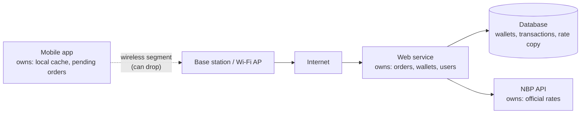

# Architecture sketch

## Request path

```
 [ Mobile app ]                                   (owns: local cache of rates,
   |  local cache (last rates + date)               pending orders not yet confirmed)
   |
   |  ~~~~~ WIRELESS SEGMENT (Wi-Fi / LTE / 5G) ~~~~~   <- may be slow, drop, or lose responses
   |
 [ Access point / base station ] -> [ Internet ]
   |
   v
 [ Web service (REST API) ]                       (owns: orders, wallets, user accounts;
   |            |                                   decides if an order succeeded)
   |            |
   v            v
 [ Database ]  [ NBP API ]                        NBP owns: official exchange rates
 (wallets,      api.nbp.pl                        (we only keep a copy with its date)
  transactions,
  rate copy)
```

Mermaid version (renders on GitHub):



## Data owners

| Data | Owner (source of truth) | Copies |
| --- | --- | --- |
| Exchange rates | NBP | Server DB copy (with effective date), phone cache |
| Wallet balance | Web service / database | Phone shows last known value |
| Orders / transactions | Web service / database | Phone keeps a pending order until confirmed |
| User account | Web service / database | Phone keeps login token |

## Example request: get EUR rate

1. App sends `GET /rates/EUR` over the wireless link.
2. Web service returns its stored rate if it is from today, otherwise calls
   `https://api.nbp.pl/api/exchangerates/rates/A/EUR/?format=json`.
3. Response includes the rate **and its effective date**; the app saves it
   to the local cache and shows the date.

## Example request: buy 100 EUR

1. App creates an order with a unique `order_id` and saves it as *pending*.
2. App sends `POST /orders` with `order_id` over the wireless link.
3. Server checks the rate and balance, writes the transaction, replies OK.
4. App marks the order as *confirmed*. If no reply came, the app asks
   `GET /orders/{order_id}` later instead of sending a second order.
