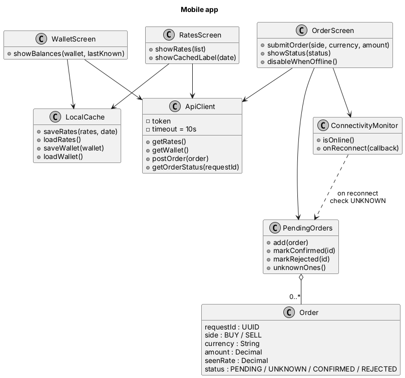
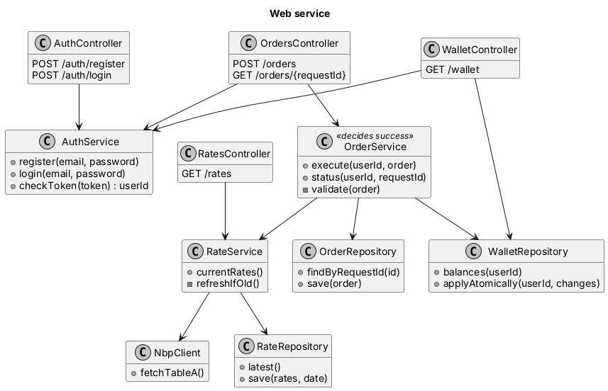

# Classes

## Mobile app

The screens don't talk to the server directly; they go through `ApiClient`,
which has a 10 second timeout. `LocalCache` keeps the last rates and wallet,
so I can still show something offline. `ConnectivityMonitor` tells the order
screen when the phone is offline (to disable the buttons) and when it comes
back. Every order the user makes goes into `PendingOrders` until the server
answers. If the answer never came, the order stays `UNKNOWN`, and after
reconnecting the app asks the server what happened to it.

## Web service

The controllers are the REST endpoints. `RateService` gives rates from the
database and only calls NBP (through `NbpClient`) when the saved rates are
old. `OrderService` handles buy and sell.

**Who decides if an action worked:** `OrderService` on the server. Its answer
is the row saved in the orders table under the order's `requestId`.
The phone never decides by itself. It only shows what the server confirmed.
