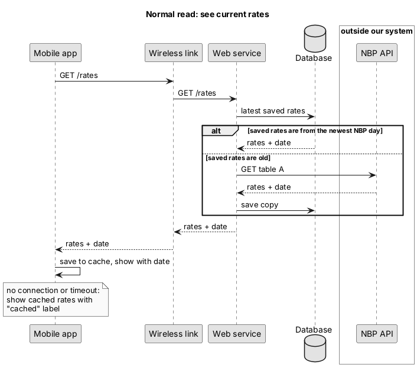
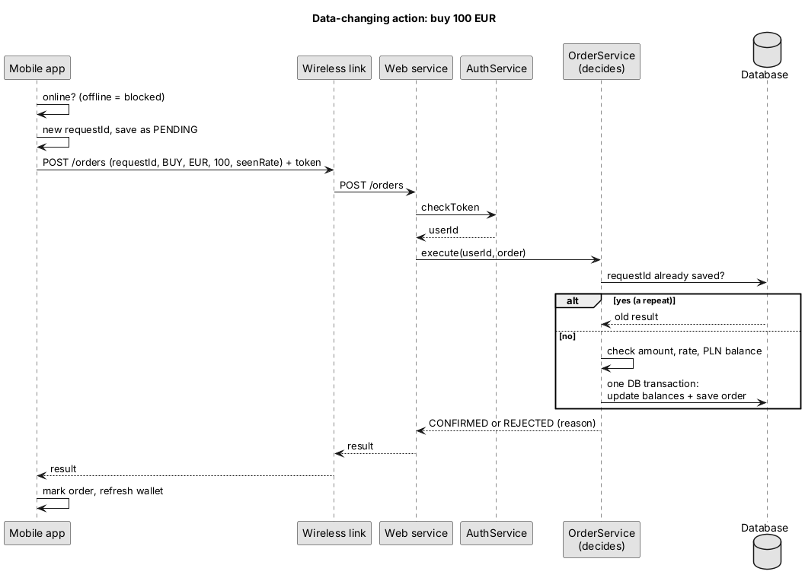
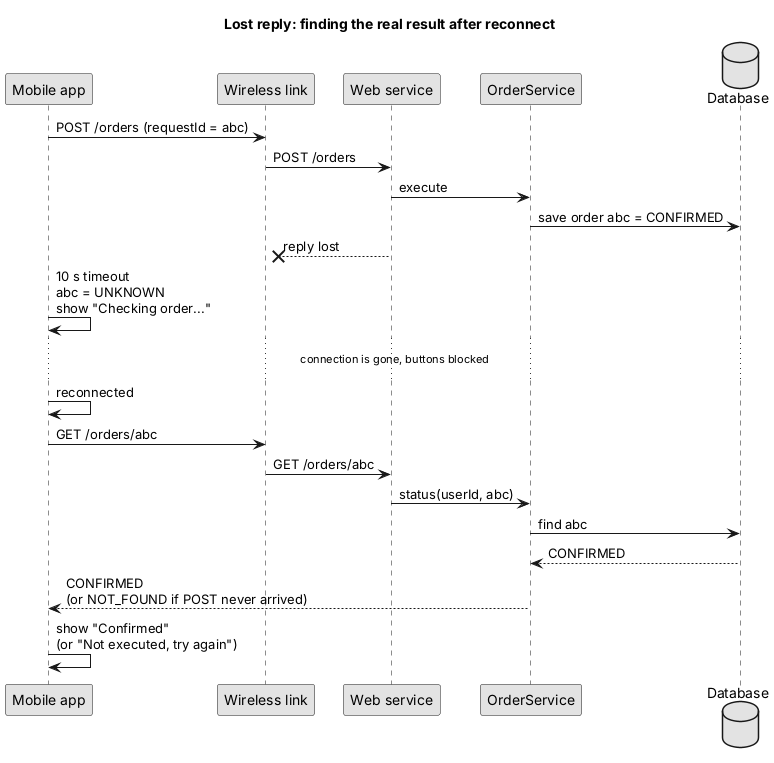

# Data flow

## 1. Normal read: see current rates

The phone asks my server, not NBP directly. If the server already has
today's rates it returns them. If not, it gets them from NBP, saves a copy
and returns that. The rates always come with their date, so the user can
see how fresh they are. If there is no connection, the phone shows the
cached rates with a "cached" label instead.

## 2. Action that changes data: buy 100 EUR

## 3. When the reply is lost

Here the order did go through on the server, but the reply got lost on the
way back. The phone can't know if it worked, so it shows "Checking
order..." instead of an error. After reconnecting, it asks the server about
order `abc` and shows the real answer. If the server never got the order,
it answers `NOT_FOUND` and the user can just try again.

## Explaining one path: buying 100 EUR

When I press Buy, the app first checks that I'm online. If I'm not, the
button is disabled. Then it gives the order a random `requestId` and saves
it on the phone as PENDING. The order goes to the server together with the
rate I saw and my login token.

On the server, `AuthService` checks the token. Then `OrderService` looks
whether this `requestId` is already in the database. If it is, the phone
is just repeating itself, so the server sends back the old result and does
nothing again. If it's new, the server checks that the amount is OK, that
the rate hasn't changed and that I have enough PLN. Then it changes both
balances and saves the order in one database transaction, so two orders at
the same time can't both spend the same money.

The server answers CONFIRMED or REJECTED and the phone just shows that. The
server is the one who decides. If the answer gets lost, flow 3 shows what
happens next.
