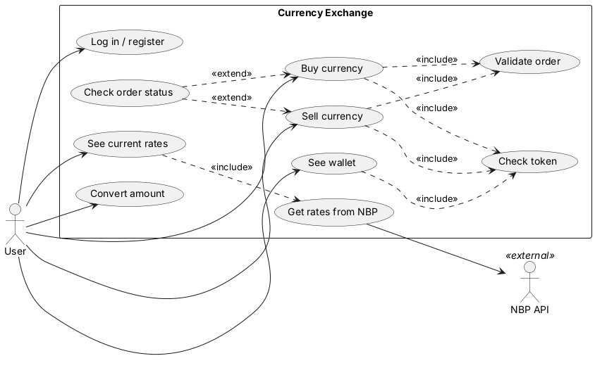

# Use cases

I drew the diagrams in PlantUML. The `.puml` files in `docs/diagrams/` are
the editable source and the `.png` files are the exported pictures. To
change a diagram, edit the `.puml` file and export it again (for example
with the PlantUML plugin in VS Code, or at plantuml.com).

There are two actors. The **User** is the person with the app. **NBP API**
is outside my system. It is where the exchange rates come from, and my
server only keeps a copy of them.

Things the user can do:

- log in or register
- see current rates and convert an amount
- see the wallet (every new user starts with 1000 virtual PLN)
- buy currency, sell currency

I kept the list short on purpose. The interesting part of this course is
what happens when the network fails, and that is already covered by buy,
sell and the cached rates.

Reads (rates, wallet) can be shown from the phone's cache when there is no
internet, with a "cached" label. Buy and sell change
money on the server, so they are blocked when the phone is offline. This
is the decision from Lab 02.

"Check token" is included in everything that touches the wallet, because
the server has to know who is asking. Buy and sell also include "Validate
order", where the server checks the amount, the rate and the balance.

"Check order status" is an extend: it only happens when the phone sent an
order but did not get the answer back (timeout or lost connection).
